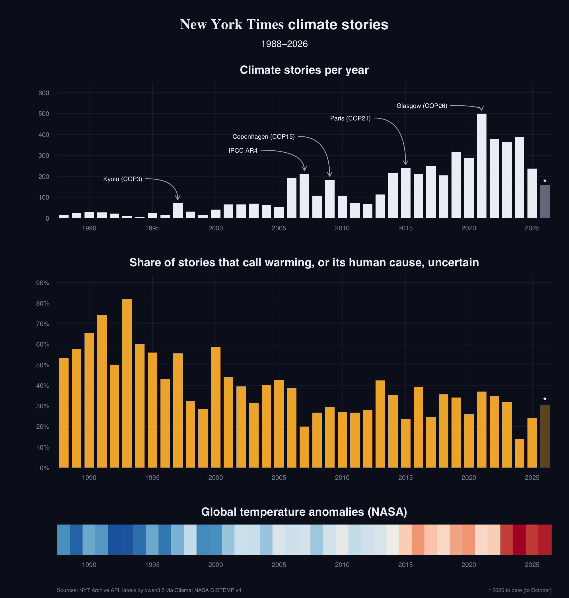

# How often do New York Times climate stories hedge on the science?

An open-source language model, running locally, reads 2,930 *New York Times* climate stories from 1988 to 2026. For each one it judges whether the story treats global warming, or its human cause, as **fact**, as **uncertain**, or **doesn't say**. A hand-labelled sample checks the model against a human reader.



## The question

In the late 1980s and 1990s, US newspapers often gave climate skeptics equal space with scientists. Boykoff & Boykoff (2004) call this "balance as bias": the coverage made the science look less settled than it was. This project asks how often NYT news stories presented warming as uncertain, and how that changed over 38 years of rising temperatures.

## Pipeline

| Step | Script | What it does |
|---|---|---|
| 1 | `code/1_download_nyt.R` | Downloads all 466 months of the NYT Archive API (Jan 1988 – Oct 2026; 3.4 million items), at the API's rate limit. Keeps items with one of four climate subject tags. Resumes where it stopped |
| 2 | `code/2_clean_stories.R` | Keeps news stories only, drops blog posts and duplicates, counts stories per year, and samples at most 100 a year (seed 6850) |
| 3 | `code/3_hand_sample.R` | Draws 30 stories for me to label by hand, before the model runs |
| 4 | `code/4_label_stories.R` | Asks a local model two questions per story with a fixed answer format. Every raw reply is saved as JSON, so reruns make no new calls |
| 5 | `code/5_hand_check.R` | Scores the model against my labels: agreement, base rate, confusion tables, every disagreement |
| 6 | `code/6_make_figure.R` | Combines the counts, the labels and NASA GISTEMP temperatures into the three-panel figure |

**Filters**

| Step | Stories |
|---|---:|
| Every item in the archive | 3,435,087 |
| With a climate subject tag | 16,516 |
| News stories only | 11,550 |
| Not a blog post | 10,410 |
| Not a duplicate | 10,395 |
| Sampled for the model (≤ 100 a year) | 2,930 |
| Climate is the main subject (per the model) | 1,787 |

## The model

- **Model:** `qwen3.5:4b-q4_K_M`, run locally through Ollama from R (`ellmer`); the 4b size fits an 8 GB laptop
- **Settings:** temperature 0, fixed seed, thinking off, one fresh conversation per story
- **Answers:** a JSON schema, so only the allowed labels are possible
- **Prompts:** written as a codebook, with one line per label and rules for borderline cases ([`code/prompt_climate.txt`](code/prompt_climate.txt), [`code/prompt_hedging.txt`](code/prompt_hedging.txt))
- **Run:** 4,717 calls, median 2.9 seconds each, 4 hours in total

## Validation: a hand check against my own labels

| Question | Model agrees with me | Base rate (always the most common label) |
|---|---:|---:|
| Is climate the main subject? (30 stories) | 0.77 | 0.67 |
| Fact, uncertain or not stated? (16 stories) | 0.44 | 0.56 |

The model is useful as a climate filter. On the hedging question it does **worse than always answering "fact"**: it over-calls "uncertain", sometimes with no hedging words quoted at all. A revised prompt (v2, adding a rule against unsupported "uncertain" labels) raised agreement from 0.38 to 0.44, but the 4b model mostly ignored the rule.

## Results

- **Coverage** spikes at each major climate event: Kyoto 1997, IPCC AR4 2007, Copenhagen 2009, Paris 2015, and Glasgow 2021, the largest.
- **The share labelled "uncertain" falls:** 59% in 1988–97, 40% in 1998–2006, 30% in 2007–26. That direction matches Boykoff & Boykoff's account of the press moving away from false balance.
- **The level is too high to trust.** Given the hand check, the model overstates hedging, so the decline is the robust finding and the exact shares are not.

## Reproduce

Requires R (httr2, jsonlite, ellmer, magick, ragg), a free NYT Developer API key, and Ollama with the model pulled.

```r
# in R, with the project open (hw4.Rproj)
source("code/run_everything.R")
```

Without an NYT key, `run_everything.R` only redraws the figure, from the two committed CSV files in `data_clean/`. The full pipeline takes about 1.5 hours of downloads and 4 hours of model calls. The NYT's terms don't allow redistributing article text, so the raw months, the sample and the model's replies are not in this repository.

## Repository layout

- `code/`: the numbered scripts, `run_everything.R`, shared helpers, and the two prompts
- `data_clean/`: per-year story counts and the model's labels (ids, dates, labels; no text)
- `figures/`: the figure
- `NOTES.md`: detailed notes: every check in the code, the patterns, the hand-check disagreements

## Credits

- **Course:** a project for AEM 6850 at Cornell University (Fall 2026), taught by Professor Ariel Ortiz-Bobea. The question, the target figure's design and the course's coding conventions are from the course.
- **Data:**
  - [NYT Archive API](https://developer.nytimes.com/)
  - [NASA GISTEMP v4](https://data.giss.nasa.gov/gistemp/)
  - the NYT nameplate image from [Wikimedia Commons](https://commons.wikimedia.org/wiki/File:The_New_York_Times_Logo.svg) (a trademark of The New York Times)
- **Reference:** Boykoff, M. T., & Boykoff, J. M. (2004). Balance as bias: global warming and the US prestige press. *Global Environmental Change*, 14(2), 125–136.
- **AI use:**
  - Claude (Anthropic) helped write and debug the code and match the figure to the target.
  - I labelled the validation sample, chose and tested the prompt versions, and judged the model's disagreements.
